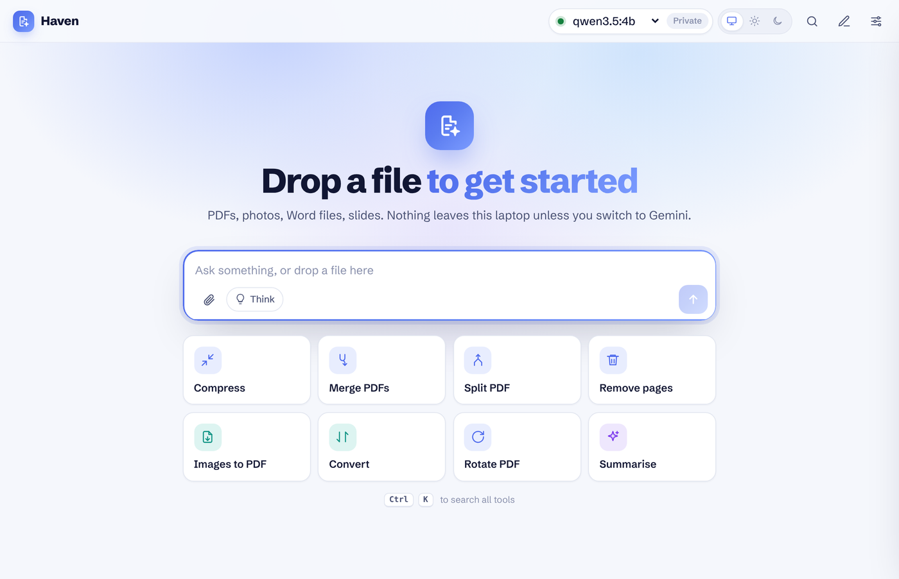
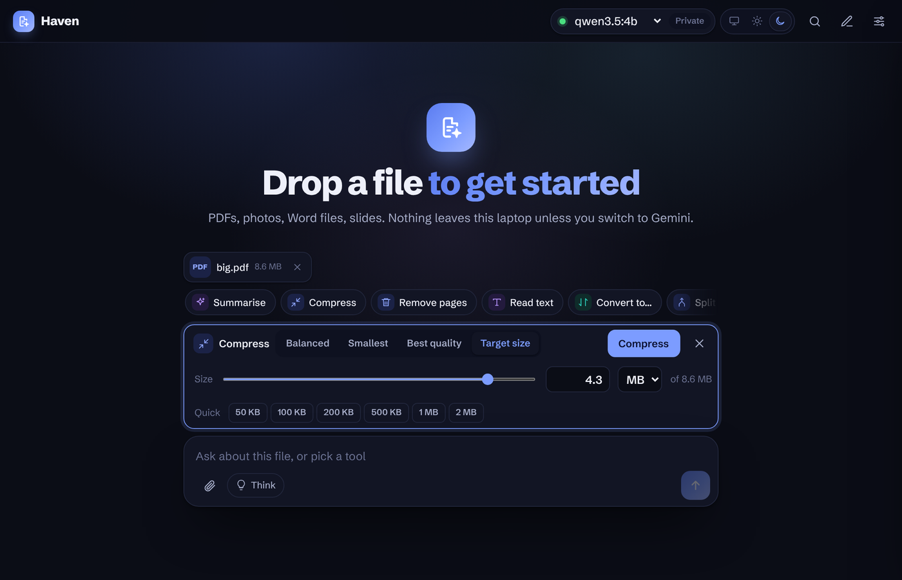

# Haven

A PDF and file toolkit for Windows that runs on your own PC, with a local AI assistant built in.

I built Haven because I didn't want to keep uploading marksheets, ID scans and work documents to random "free PDF" websites just to shrink or merge them. Everything here happens on your laptop. The AI part runs through [Ollama](https://ollama.com), so it works offline too. If you want a stronger model for something that isn't sensitive, you can add your own Gemini key.



## What it does

**PDF**
- Compress, either to a preset level or to an exact size ("under 200 KB" for an upload portal). It shows the size before and after.
- Merge, split, remove pages, keep pages, rotate
- Images to PDF, PDF to images, pull text out of a PDF

**Images**
- Compress to a target size, convert between PNG, JPG, WebP, HEIC and ICO

**Convert**
- Pick a file and Haven lists what it can turn it into. That covers Word, PowerPoint and Excel to PDF, PDF to Word, video to MP3 or GIF, audio formats, Markdown, CSV and JSON.

**AI**
- Chat with a local model, with a Think switch for harder questions
- Summarise a PDF or ask questions about it, read text from scans and photos, rewrite or translate text, explain an image
- Optional Gemini models. The top bar always shows whether you are on a local model or a cloud one.

It also has light and dark themes (or follows Windows), drag and drop, and a Ctrl+K search for every tool.



## Install

### Download
Get `Haven-windows.zip` from [Releases](../../releases), unzip it anywhere and run `Haven.exe`. You don't need Python.

### Run from source
You need Windows 10 or 11 and Python 3.10 to 3.13.

```bat
git clone https://github.com/himank09/haven.git
cd haven
setup.bat
```

`setup.bat` creates a virtual environment, installs the dependencies and adds Haven to your desktop and Start menu. After that, open Haven from there, or use `run.bat` (`run.bat debug` keeps a console open so you can see errors).

### Optional add-ons
None of these are required. Haven tells you in Settings which ones it found.

| Add-on | What it unlocks | How to get it |
|---|---|---|
| Ollama + a model | Local AI chat and AI tools | `winget install -e --id Ollama.Ollama`, then `ollama pull qwen3.5:4b` |
| LibreOffice | Word, PowerPoint and Excel conversions | `winget install -e --id TheDocumentFoundation.LibreOffice` |
| Ghostscript | Smaller results when compressing PDFs | 64-bit installer from [ghostscript.com](https://ghostscript.com/releases/gsdnld.html) |

On a laptop without a graphics card, a 4B model is a good balance of speed and quality. Turn Think off for quick answers.

## Gemini
Open Settings, paste a key from [Google AI Studio](https://aistudio.google.com/apikey) and pick a model. The key is stored only on your PC in `%APPDATA%\Haven\settings.json`, or you can set the `GEMINI_API_KEY` environment variable instead. It never goes into this repository.

## Privacy
- File tools never touch the internet.
- Local models never touch the internet.
- With a Gemini model selected, your message and any attached files go to Google under [their API terms](https://ai.google.dev/gemini-api/terms).
- The app's server listens only on `127.0.0.1` and checks a token that changes every launch, so other devices and websites can't use it.
- No accounts, no analytics.

## Build the .exe
```bat
build.bat
```
This produces `dist\Haven\Haven.exe`. Pushing a tag such as `v0.9.0` also makes GitHub Actions build the app and attach the zip to a release.

## How it's put together
```
app.py              desktop window (pywebview) that starts the local server
haven/server.py     FastAPI backend: AI routing, PDF and image tools
haven/convert.py    the converter (Pillow, pypdf, ffmpeg, LibreOffice)
haven/web/          the interface, a single HTML file with no CDN, so it works offline
```

## License
MIT, see [LICENSE](LICENSE). The bundled Schibsted Grotesk font is under the SIL Open Font License.
