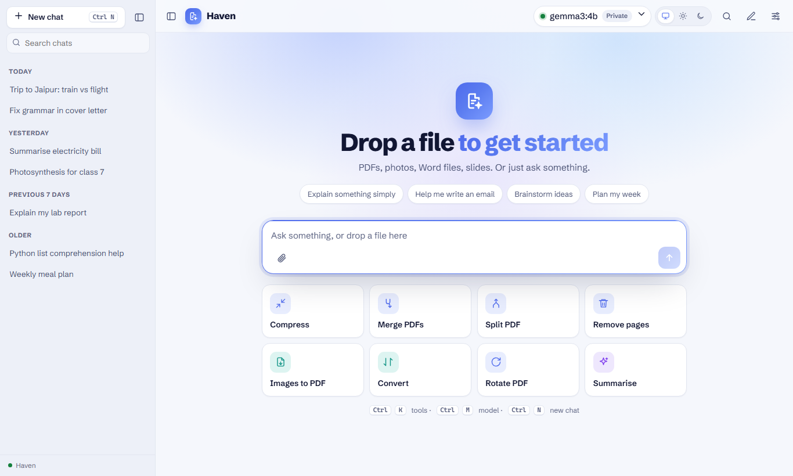
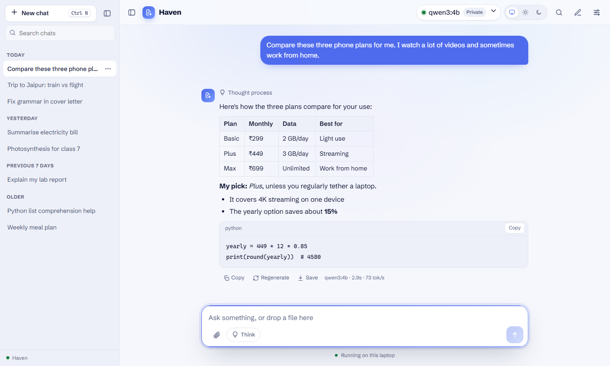
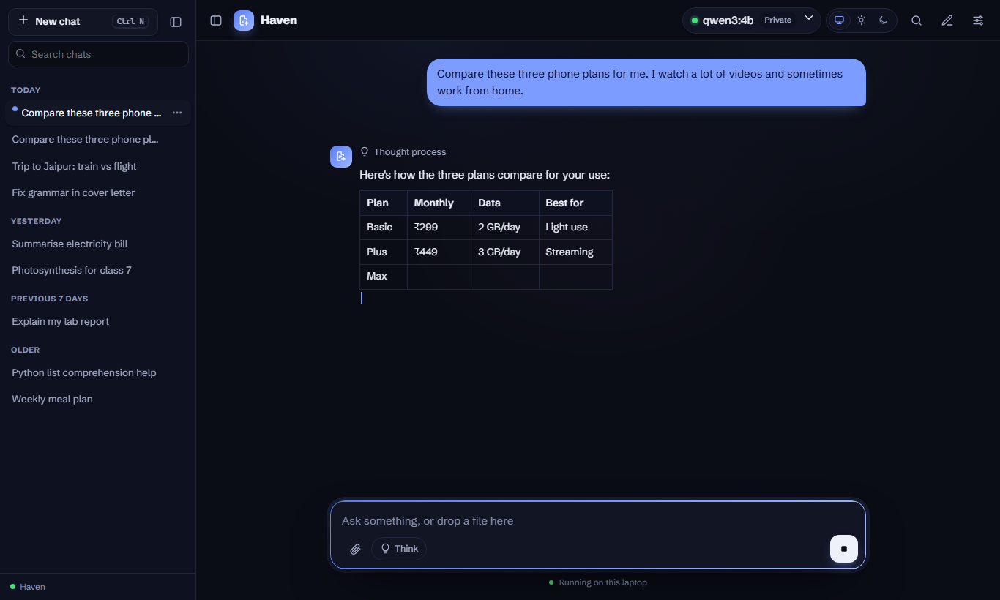
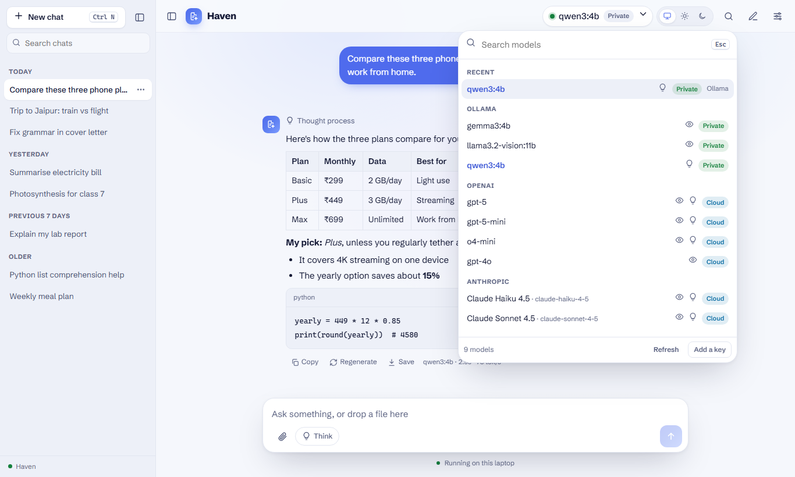
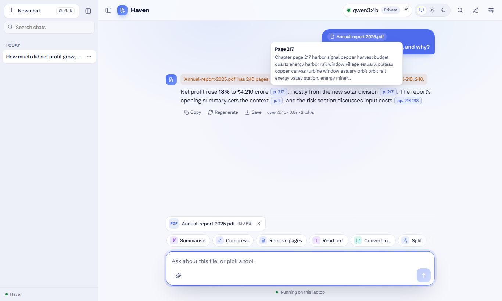

# Haven

A PDF and file toolkit for Windows that runs on your own PC, with an AI assistant built in that can use a local model or almost any cloud model.

I built Haven because I didn't want to keep uploading marksheets, ID scans and work documents to random "free PDF" websites just to shrink or merge them. Everything here happens on your laptop. The AI part can run through [Ollama](https://ollama.com) or LM Studio, so it works offline too. When you want a stronger model for something that isn't sensitive, paste a key from almost any provider, and Haven hides your personal details before anything leaves the PC.



## What it does

**PDF**
- Compress, either to a preset level or to an exact size ("under 200 KB" for an upload portal). It shows the size before and after.
- Merge, split, remove pages, keep pages, rotate
- Images to PDF, PDF to images, pull text out of a PDF

**Images**
- Compress to a target size, convert between PNG, JPG, WebP, HEIC and ICO

**Convert**
- Pick a file and Haven lists what it can turn it into. That covers Word, PowerPoint and Excel to PDF, PDF to Word, video to MP3 or GIF, audio formats, Markdown, CSV and JSON.

**AI chat**
- Works with local models (Ollama, LM Studio) and cloud providers: OpenAI, Anthropic, Google Gemini, OpenRouter, Groq, xAI, DeepSeek, Mistral, Together, Fireworks, Cerebras, Hugging Face, or any OpenAI-compatible server (vLLM, LiteLLM, a company gateway).
- Paste a key and Haven works out which provider it belongs to, checks it, and lists that provider's chat models. You can keep several keys, including two for the same provider (personal and work).
- Chats are saved on your PC, with a sidebar, search inside messages, rename, delete with undo and export to Markdown.
- Proper formatting: tables, code blocks with a Copy button, lists, links. Stop, regenerate, edit a message, switch models in the middle of a chat.
- **Page citations for long PDFs.** Ask about a 300-page report and Haven picks the relevant pages instead of cutting the document off. Answers cite pages like `(p. 217)`; hover a citation to see that page.
- **Privacy Shield.** Before a message goes to a cloud model, phone numbers, emails, PAN, Aadhaar, card numbers, IFSC codes and UPI IDs are swapped for placeholders like `[PHONE_1]`. The answer shows the real values again, on your PC only.
- Summarise a PDF or ask questions about it, read text from scans and photos, rewrite or translate text, explain an image.

It also has light and dark themes (or follows Windows), drag and drop, and keyboard shortcuts for everything (see below).

| | |
|---|---|
|  |  |
|  |  |

## Install

### Download
Get `Haven-windows.zip` from [Releases](../../releases), unzip it anywhere and run `Haven.exe`. You don't need Python.

### Run from source
You need Windows 10 or 11 and Python 3.10 to 3.13.

```bat
git clone https://github.com/himank09/haven.git
cd haven
setup.bat
```

`setup.bat` creates a virtual environment, installs the dependencies and adds Haven to your desktop and Start menu. After that, open Haven from there, or use `run.bat` (`run.bat debug` keeps a console open so you can see errors).

### Optional add-ons
None of these are required. Haven tells you in Settings which ones it found.

| Add-on | What it unlocks | How to get it |
|---|---|---|
| Ollama + a model | Private AI chat and AI tools | `winget install -e --id Ollama.Ollama`, then `ollama pull qwen3.5:4b` |
| LM Studio | Private AI chat with models you load there | [lmstudio.ai](https://lmstudio.ai), then start its local server |
| LibreOffice | Word, PowerPoint and Excel conversions | `winget install -e --id TheDocumentFoundation.LibreOffice` |
| Ghostscript | Smaller results when compressing PDFs | 64-bit installer from [ghostscript.com](https://ghostscript.com/releases/gsdnld.html) |

On a laptop without a graphics card, a 4B model is a good balance of speed and quality. Turn Think off for quick answers.

## Cloud models

Open **Settings → AI providers**, paste a key and press **Add**. Haven recognises the provider from the key, checks that it works and adds that provider's chat models to the model picker (**Ctrl M**). If it can't tell which provider a key belongs to, it asks you to pick, and **Custom** takes any OpenAI-compatible base URL.

| Provider | Key looks like | Notes |
|---|---|---|
| Ollama | no key | found automatically on this PC |
| LM Studio | no key | found automatically when its server is running |
| OpenAI | `sk-…`, `sk-proj-…` | |
| Anthropic | `sk-ant-…` | |
| Google Gemini | `AIza…` | free key from [Google AI Studio](https://aistudio.google.com/apikey) |
| OpenRouter | `sk-or-…` | hundreds of models; use the picker's search |
| Groq | `gsk_…` | |
| xAI | `xai-…` | |
| DeepSeek | `sk-…` | same prefix as OpenAI; Haven tries both |
| Mistral | no fixed prefix | Haven tries Mistral and Together |
| Together | no fixed prefix | |
| Fireworks | `fw_…` | if it can't list models for your key, add a model id by hand |
| Cerebras | `csk-…` | |
| Hugging Face | `hf_…` | Inference Providers router |
| Custom | anything | any OpenAI-compatible server, with its base URL |

**Where keys are kept.** Keys go into Windows Credential Manager (encrypted for your Windows account). `settings.json` only holds the provider name, your label and the last four characters. If Credential Manager isn't available, Haven says "Stored in a plain file on this PC" in Settings. Keys in environment variables (`OPENAI_API_KEY`, `ANTHROPIC_API_KEY`, `GEMINI_API_KEY` and so on) show up as read-only. Haven never shows a full key again, and keys never go into this repository, logs or the chat database.

Upgrading from 0.9? Your Gemini key moves to Credential Manager automatically, and your old chat history appears in the sidebar as "Earlier chats".

## Privacy: what leaves your PC, and when

| You use | What leaves this PC |
|---|---|
| File tools (compress, merge, convert…) | Nothing. Ever. |
| A local model (Ollama, LM Studio) | Nothing. Your messages and files stay on the PC. |
| A cloud model, Privacy Shield **on** (default) | Your message, earlier messages in that chat and the text of attached PDFs, **with personal details replaced** by placeholders. |
| A cloud model, Privacy Shield **off** | Your messages and files as written. A note in the chat says so. |
| A cloud model with a photo or scanned PDF | Only after you say yes (once per chat): the shield can't read inside images. |

- The Privacy Shield looks for phone numbers, emails, PAN, Aadhaar, card numbers (checked with the Luhn checksum, so random 16-digit numbers are left alone), IFSC codes and UPI IDs. The real values stay on your PC: the answer and anything you copy show them again, and the saved chat keeps them. The note under an answer tells you what was hidden, for example "Privacy Shield hid 2 phone numbers and 1 PAN before sending to OpenAI."
- It can't catch everything (names and addresses, for example), so for something truly sensitive, use a local model.
- The model picker and the top bar always show **Private** or **Cloud**.
- Chats are stored in `%APPDATA%\Haven\haven.db` on your PC. Attached files aren't stored, only their names and sizes.
- The app's server listens only on `127.0.0.1` and checks a token that changes every launch, so other devices and websites can't use it. Model output is treated as untrusted: it can't run scripts or load anything from the internet.
- No accounts, no analytics.

## Keyboard shortcuts

| Keys | Does |
|---|---|
| Enter / Shift+Enter | Send / new line |
| Esc | Stop the answer (or close whatever is open) |
| ↑ in an empty box | Edit your last message |
| Ctrl+N | New chat |
| Ctrl+M | Pick a model |
| Ctrl+K | Search all tools |
| Ctrl+Shift+F | Search your chats |

## Build the .exe
```bat
build.bat
```
This produces `dist\Haven\Haven.exe`. Pushing a tag such as `v1.0.0` also makes GitHub Actions build the app and attach the zip to a release.

## Tests
```bat
.venv\Scripts\python.exe -m pip install -r requirements-dev.txt
.venv\Scripts\python.exe -m playwright install chromium
.venv\Scripts\python.exe -m pytest -q
```
The suite uses fake AI providers, so it needs no keys or internet. See [tests/README.md](tests/README.md), including the optional live test against real providers.

## How it's put together
```
app.py               desktop window (pywebview) that starts the local server
haven/server.py      FastAPI backend: file tools, settings, chat and provider endpoints
haven/providers/     one adapter per API style (OpenAI-compatible, Anthropic, Gemini, Ollama),
                     key detection, model lists, key storage
haven/chat.py        the chat pipeline: attachments, citations, Privacy Shield, saving answers
haven/docs.py        PDF text per page, retrieval (BM25) and page citations
haven/shield.py      Privacy Shield detectors and placeholders
haven/storage.py     chats in SQLite
haven/convert.py     the converter (Pillow, pypdf, ffmpeg, LibreOffice)
haven/web/           the interface: plain HTML, CSS and JavaScript with no CDN, so it works offline
```

## License
MIT, see [LICENSE](LICENSE). The bundled Schibsted Grotesk font is under the SIL Open Font License.
