<div align="center">

# Haven

**A private PDF and file toolkit for Windows, with an AI assistant that works with any model: on your own PC or in the cloud.**

Compress, merge, split and convert files without uploading them anywhere. Chat with local models through Ollama or LM Studio, or bring your own key for OpenAI, Claude, Gemini and ten more providers. Ask questions about 300-page PDFs and get answers with page numbers. Personal details are hidden before anything goes to the cloud.

   

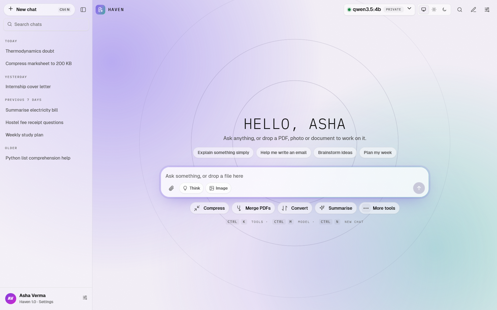

</div>

## Why I built it

I didn't want to keep uploading marksheets, ID scans and work documents to random "free PDF" websites just to shrink or merge them. Haven does all of that on your laptop. The AI assistant can stay on your laptop too, with a local model. When you do want a stronger cloud model, Haven lets you use your own key with almost any provider, and hides your phone number, PAN, Aadhaar and similar details before your message leaves the PC.

## Contents

- [What it can do](#what-it-can-do)
- [File tools](#file-tools)
- [AI chat](#ai-chat)
- [Make pictures](#make-pictures)
- [Long PDFs with page citations](#long-pdfs-with-page-citations)
- [Privacy Shield](#privacy-shield)
- [Models and keys](#models-and-keys)
- [Your profile](#your-profile)
- [Privacy: what leaves your PC, and when](#privacy-what-leaves-your-pc-and-when)
- [Install](#install)
- [Keyboard shortcuts](#keyboard-shortcuts)
- [Troubleshooting](#troubleshooting)
- [How it's built](#how-its-built)

## What it can do

| | |
|---|---|
| **PDF tools** | Compress (to a level or an exact size), merge, split, remove or keep pages, rotate, images to PDF, PDF to images, copy text |
| **Image tools** | Compress to a target size; convert between PNG, JPG, WebP, HEIC, BMP, TIFF, GIF and ICO |
| **Convert anything** | Word, PowerPoint, Excel ↔ PDF; video → MP3 or GIF; audio formats; Markdown, HTML, CSV, JSON |
| **AI chat** | Any model: Ollama and LM Studio on your PC, or OpenAI, Anthropic, Gemini, OpenRouter, Groq, xAI, DeepSeek, Mistral, Together, Fireworks, Cerebras, Hugging Face and any OpenAI-compatible server |
| **Make pictures** | Ask for a picture in the chat: free FLUX.1 schnell on Hugging Face's free Space, Cloudflare Workers AI, Pollinations, or Gemini's Nano Banana models |
| **Read your files** | Summaries, key points, practice questions, questions about a PDF with page citations, text from scans and photos |
| **Writing help** | Fix grammar, make shorter, make professional, turn into an email, translate |
| **Privacy** | Runs on `127.0.0.1` only, no accounts, no analytics; Privacy Shield for cloud models; keys in Windows Credential Manager |
| **Comfort** | Saved chats with search, a calm pastel-haze design in light and dark, math and code formatting, keyboard shortcuts, works at any display scaling |

<table>
<tr>
<td width="62%">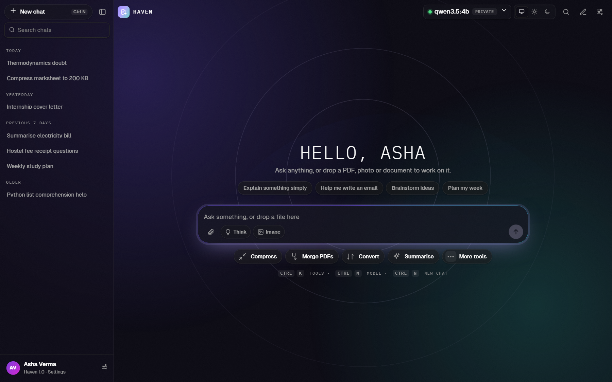</td>
<td width="38%">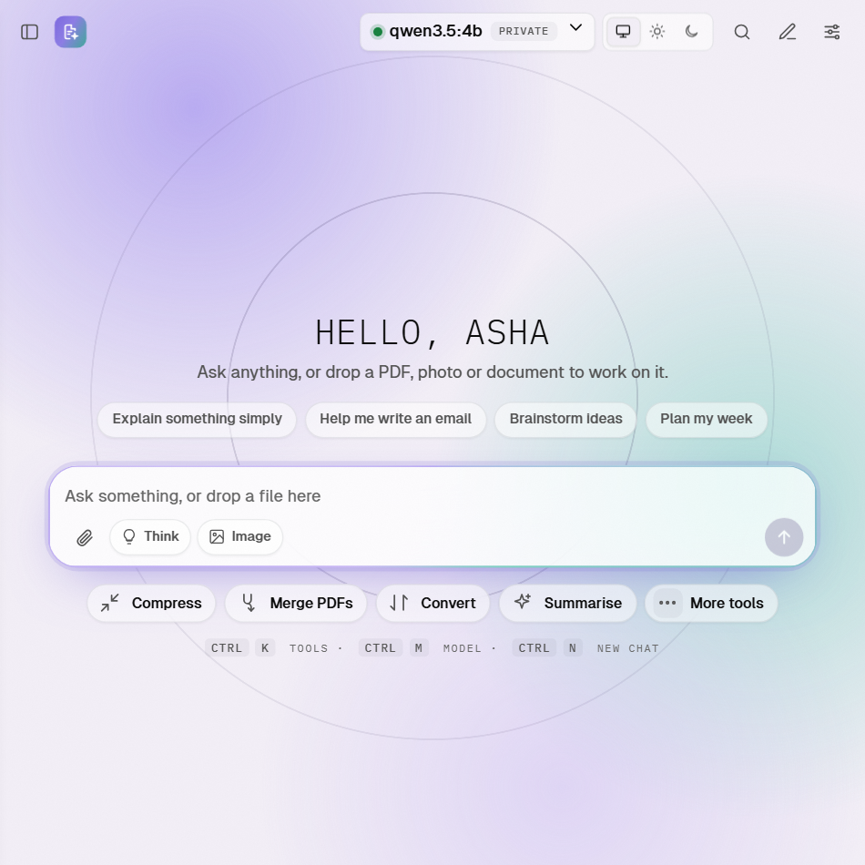</td>
</tr>
<tr>
<td>Light and dark themes, or follow Windows. A soft pastel haze with film grain and ripple rings, frosted-glass panels and gentle motion that rests when you're idle.</td>
<td>Small windows and high display scaling: the sidebar turns into a drawer.</td>
</tr>
</table>

## File tools

Drop a file anywhere on the window (or click the paperclip) and Haven shows the tools that fit it. Every file tool runs on your PC; nothing is uploaded, even when a cloud AI model is selected.

<table>
<tr>
<td width="50%">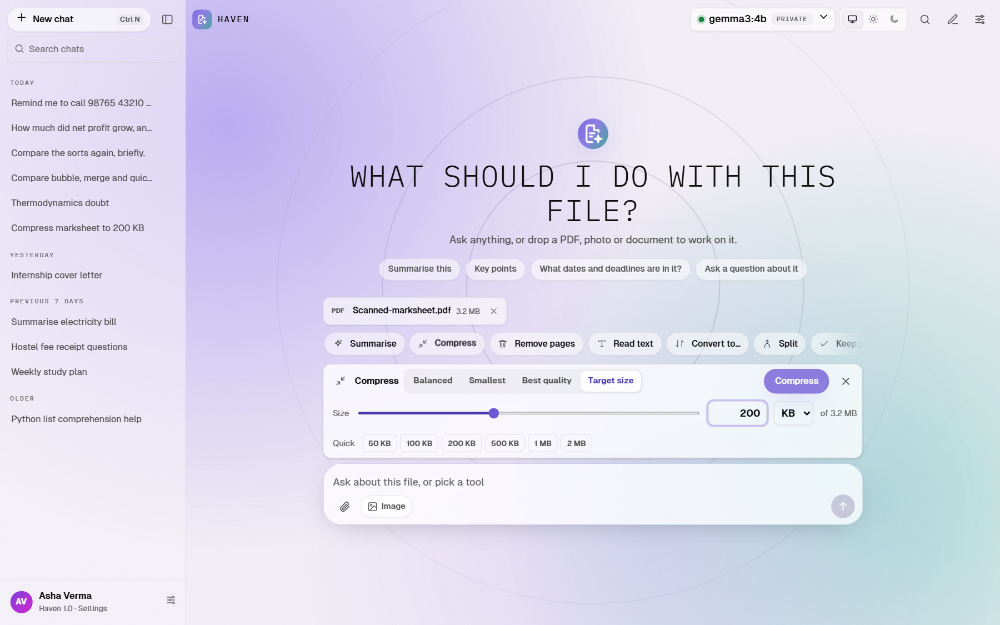</td>
<td width="50%">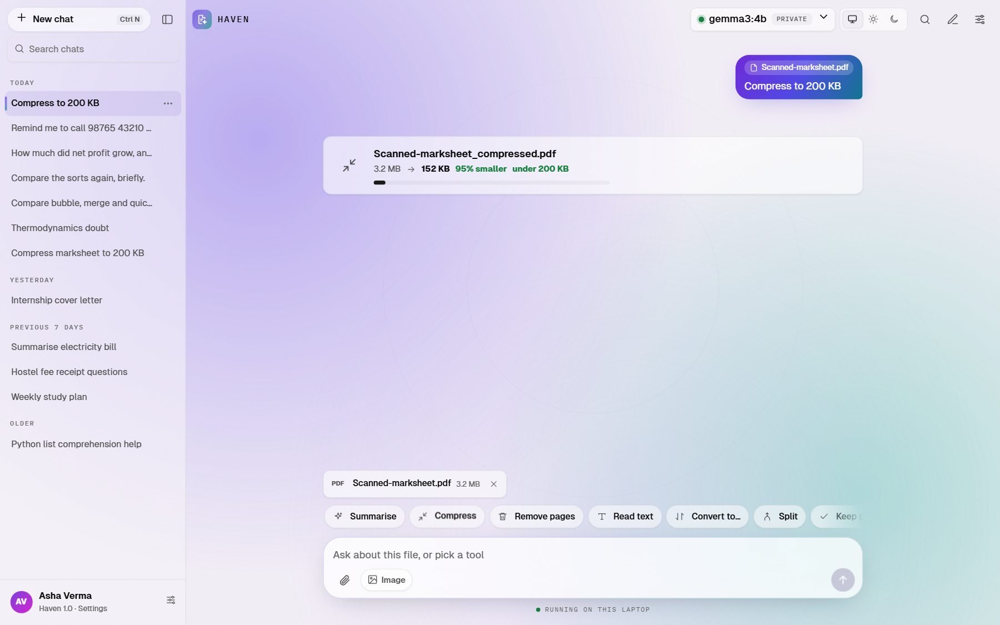</td>
</tr>
<tr>
<td><b>Compress to an exact size.</b> Pick Balanced, Smallest or Best quality, or type a target like "200 KB" for an upload portal. Quick presets for common limits.</td>
<td><b>See what you saved.</b> The result shows the size before and after, the percentage saved, and whether it got under your target. If it can't, it says so and gives you the smallest possible file.</td>
</tr>
</table>

**PDF**
- **Compress** to a preset level or a target size. Uses Ghostscript when it's installed for noticeably smaller files, and Haven's own compressor otherwise.
- **Merge** several PDFs in order. **Split** into one file per page, or by ranges like `1-3, 4-10`.
- **Remove pages** or **keep pages** (`2, 5-7`, or open ranges like `5-`). **Rotate** all pages or just some.
- **Images to PDF**, **PDF to images** (PNG or JPG; one page returns an image, many return a zip), and **copy text** from PDFs that have a text layer.
- Password-protected or damaged files get a clear message instead of an error.

**Images:** compress to a target size (transparent images stay transparent), convert between formats, and open iPhone HEIC photos.

**Convert anything:** pick a file and Haven lists what it can become. Word, Excel and PowerPoint conversions use LibreOffice if it's installed; audio and video use the bundled ffmpeg.

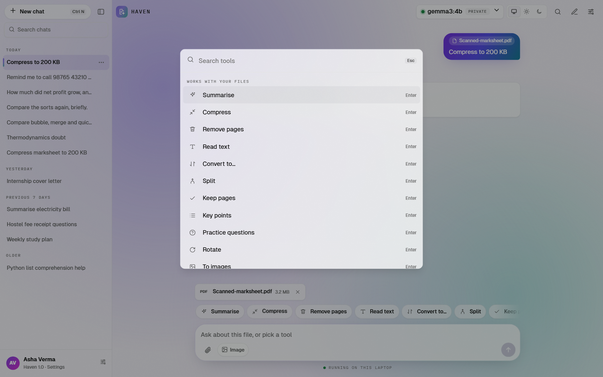

Press **Ctrl K** to search every tool. Tools that work with the files you've attached are listed first.

## AI chat

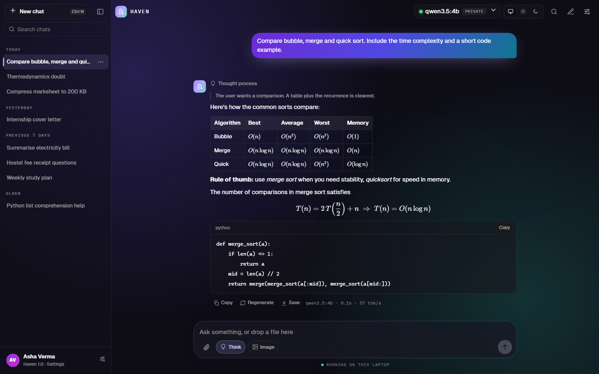

- **Any model, switched any time.** Pick from the model picker (**Ctrl M**) and keep chatting: the conversation carries over, even from a local model to a cloud one.
- **Proper formatting.** Headings, lists, tables, quotes, code blocks with a Copy button, and **math**: LaTeX like `$O(n \log n)$` and full equations are drawn with KaTeX, offline.
- **Think mode** for models that can reason, with their thinking shown in a collapsible "Thought process". It's hidden for models that can't think.
- **Stop, regenerate, edit.** Stop an answer with **Esc**, regenerate the last one, or edit an earlier message and continue from there. **↑** in an empty box edits your last message.
- **Saved chats.** Everything is saved on your PC as you go (a crash loses at most two seconds). The sidebar groups chats by day, with search inside messages, rename, delete with undo, and export to Markdown.
- **Streams smoothly**, follows the answer while you're at the bottom, and leaves you where you are if you scroll up.

<table>
<tr>
<td width="50%">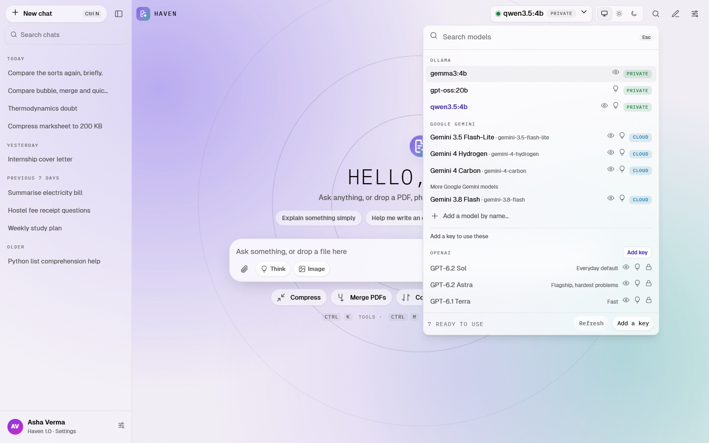</td>
<td width="50%">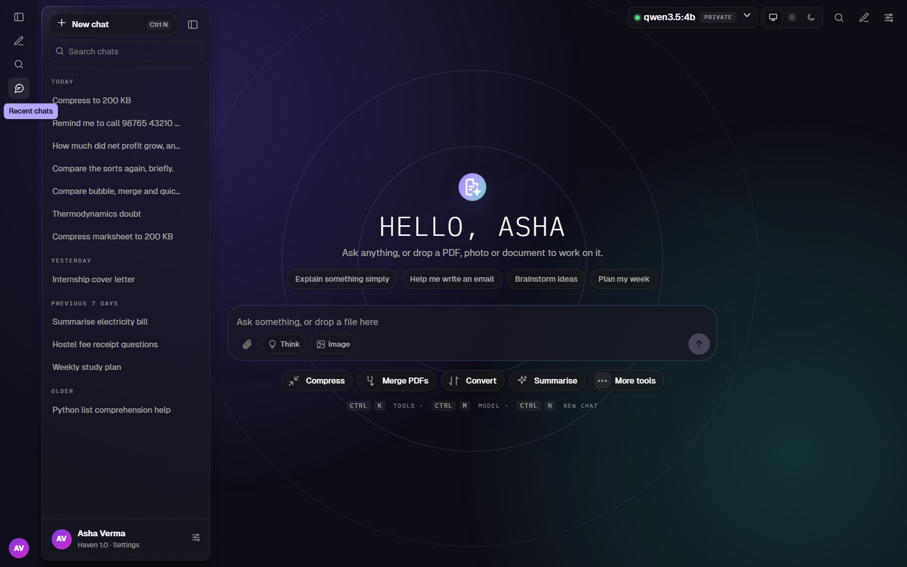</td>
</tr>
<tr>
<td><b>Model picker.</b> Grouped by provider, with <b>Private</b> or <b>Cloud</b> on every model, icons for models that can see images or think, your recent models on top, and search. Popular models from providers you haven't connected yet are listed with a lock, so you know what a key would unlock.</td>
<td><b>Collapsed sidebar.</b> Collapse the sidebar to a slim icon rail. Hover over it and your recent chats slide out; move away and they tuck back in.</td>
</tr>
</table>

## Make pictures

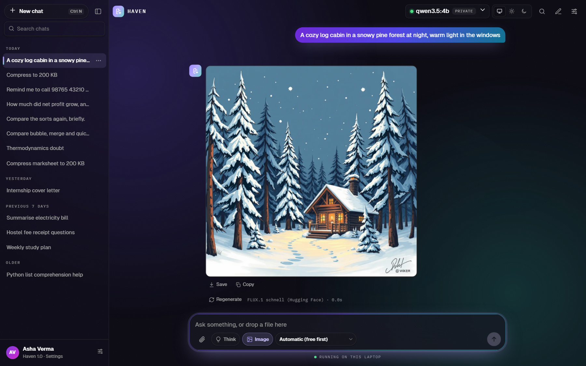

Turn on **Image** in the chat box, or just ask: "draw…", "generate an image of…", "make me a logo…". Haven asks once whether you want a picture or a text answer.

- **Pick the model** in the dropdown next to the Image button. Every model that can make a picture right now is listed, free ones first:
  - **FLUX.1 schnell · Hugging Face Space · Free.** Uses Hugging Face's free public Space; a free Hugging Face token gives you your account's daily allowance.
  - **FLUX.1 schnell · Cloudflare Workers AI · Free.** A daily free allowance with a free Cloudflare account.
  - **Pollinations · Free.** No account at all (one picture every 45 seconds; pictures carry a small pollinations.ai mark).
  - **Nano Banana models · Google Gemini** and **Stable Diffusion 3 · Hugging Face** need billing or credits on your key.
- **Automatic** tries the free ones quietly, one after another, and only tells you which one made the picture.
- If a model you picked can't make it, the answer says why in one line and offers **Try another model** buttons.
- Pictures are saved as files in `%APPDATA%\Haven\images` (not in the chat database), with **Save** and **Copy** on each one. The Privacy Shield hides personal details in your description first.

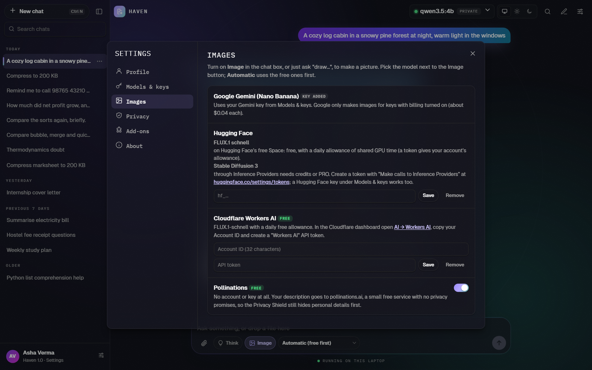

Set the services up in **Settings → Images**. Tokens are kept in Windows Credential Manager, like model keys; a Hugging Face key added under Models & keys works too.

## Long PDFs with page citations

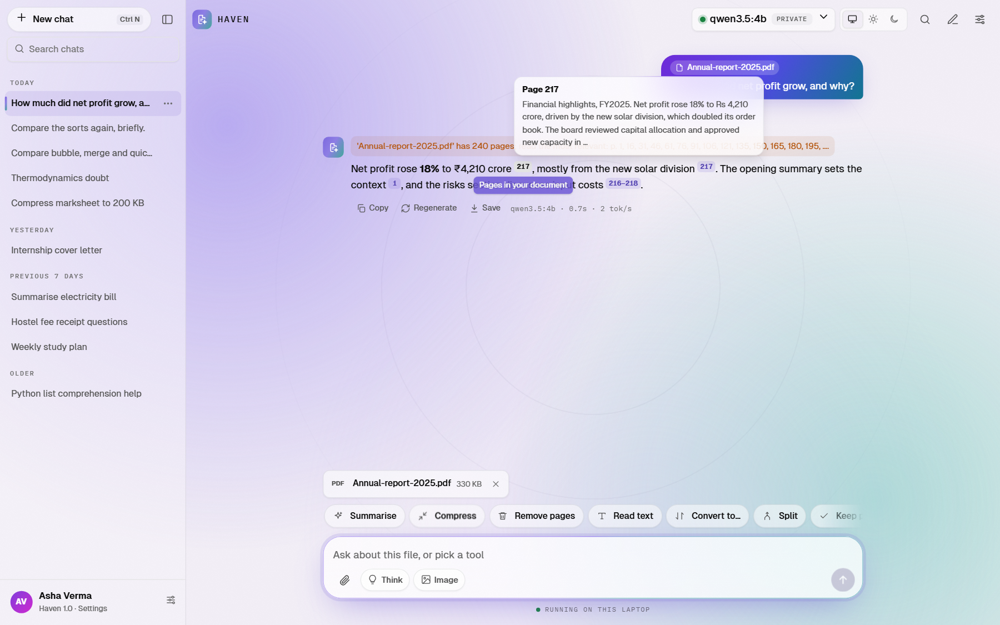

Small local models can only read a few thousand words at once, so most apps cut long PDFs off. Haven instead **finds the pages that matter**: it splits the document into passages, ranks them against your question (BM25, entirely on your PC) and sends the best ones with their page numbers, filling the model's budget.

- Answers cite pages as **(p. 217)** or **(pp. 216–218)**. Hover a citation to see the start of that page. Citations to pages that don't exist are left as plain text.
- A note tells you what was read: *"'Annual-report-2025.pdf' has 240 pages; read the most relevant: p. 1, 216-218, …"*
- **Summarise**, **Key points** and **Practice questions** read pages spread across the whole document instead.
- Several PDFs at once share the space fairly. Short PDFs are sent whole. Scanned PDFs are shown to vision models as page images.
- Big models with large context windows get much more of the document (up to about 400,000 characters).

## Privacy Shield

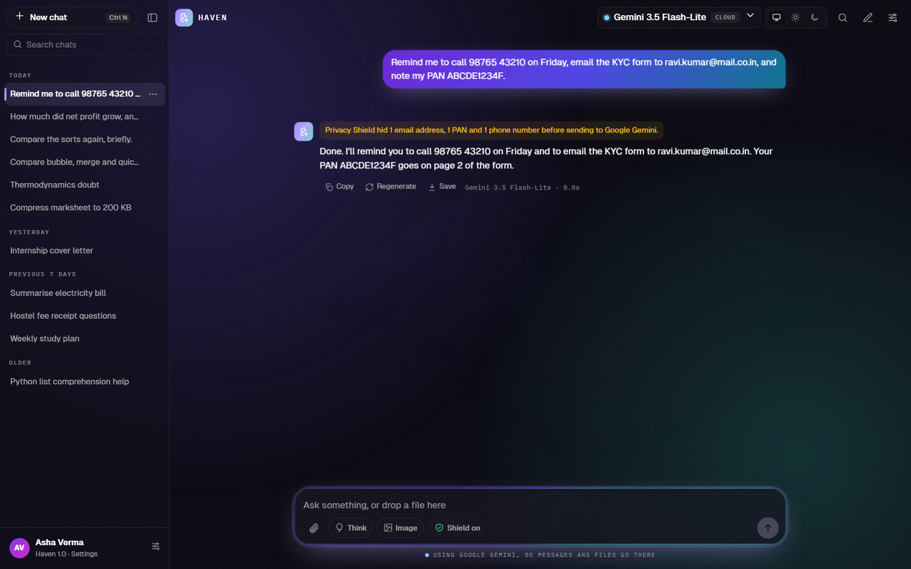

When you use a **cloud** model, the Privacy Shield replaces personal details with placeholders before anything is sent, and puts the real values back in the answer **on your PC only**.

| Hidden | Examples |
|---|---|
| Phone numbers | `+91 98765 43210`, `09876543210`, `98765-43210` |
| Email addresses | `name.surname+tag@mail.co.in` |
| PAN | `ABCDE1234F` |
| Aadhaar | `2345 6789 0123` |
| Card numbers | checked with the Luhn checksum, so random 16-digit numbers are left alone |
| IFSC codes | `SBIN0001234` |
| UPI IDs | `name@okhdfcbank`, `9876543210@ybl` |

- The model sees `[PHONE_1]`; you see your number in the answer and when you copy it. The same value always gets the same placeholder.
- It also covers earlier messages, the text of attached PDFs, and your profile notes.
- Photos and scanned pages can't be checked, so Haven asks once per chat before sending them.
- Local models get everything as written: nothing leaves the PC anyway.
- Turn it off in **Settings → Privacy** or with the **Shield** button next to the message box. A note in the chat says when it's off.
- It can't catch everything (names and addresses, for example). For something truly sensitive, use a local model.

## Models and keys

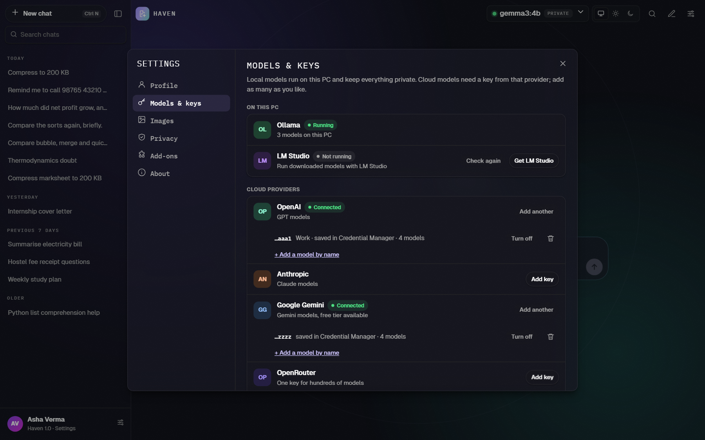

Open **Settings → Models & keys**. Every provider has a card: click **Add key**, paste it, and Haven checks it and lists that provider's chat models straight away. Each card has a **Get a key** link to the provider's page.

| Provider | Key looks like | Notes |
|---|---|---|
| **Ollama** | no key | Free models on your PC. Found automatically. |
| **LM Studio** | no key | Found automatically when its local server is running. |
| OpenAI | `sk-…`, `sk-proj-…` | |
| Anthropic | `sk-ant-…` | Claude models |
| Google Gemini | `AIza…` | Free key from [Google AI Studio](https://aistudio.google.com/apikey); some models need a paid plan |
| OpenRouter | `sk-or-…` | One key for hundreds of models |
| Groq | `gsk_…` | Very fast open models |
| xAI | `xai-…` | Grok models |
| DeepSeek | `sk-…` | Same prefix as OpenAI; Haven tries both |
| Mistral | no fixed prefix | |
| Together | no fixed prefix | |
| Fireworks | `fw_…` | |
| Cerebras | `csk-…` | |
| Hugging Face | `hf_…` | Inference Providers router |
| **Custom** | anything | Any OpenAI-compatible server (vLLM, LiteLLM, a company gateway), with its address |

- **Several keys**, even for the same provider (a personal and a work key, each with a label). Turn any of them off without deleting it.
- **Add a model by name** if a provider has one Haven doesn't list.
- **Not sure which provider a key is for?** Paste it under "Not sure which provider a key belongs to?" and Haven works it out.
- **Where keys live:** in Windows Credential Manager, encrypted for your Windows account. `settings.json` only keeps the provider, your label and the last four characters. Haven never shows a full key again, and keys never go into chats, logs or this repository. Keys in environment variables (`OPENAI_API_KEY`, `GEMINI_API_KEY`, …) show up as read-only.
- **Clear errors:** "Key rejected", "overloaded right now, try again or pick another model" (with one automatic retry), "not included in your plan", "retired for new keys", "rate limited, try again in 7s". Models that just failed are marked in the picker.

## Your profile

<table>
<tr>
<td width="50%">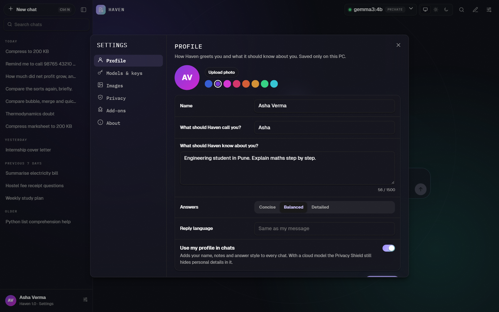</td>
<td width="50%">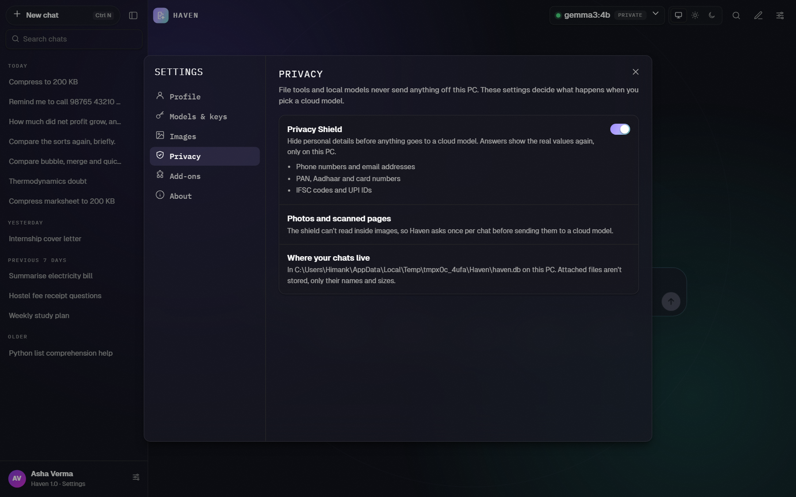</td>
</tr>
</table>

**Settings → Profile** (or click your name at the bottom of the sidebar):

- Your **name**, what Haven should **call you**, and an **avatar** (initials and a colour, or a photo, shrunk to 256 px on your PC).
- **What Haven should know about you**, for example "I'm an engineering student; explain maths step by step".
- **Answer style** (concise, balanced or detailed) and a **reply language**.
- **Use my profile in chats** decides whether any of this is sent to the model. The start screen greets you by name either way.

Everything in your profile stays on your PC unless that switch is on, and with a cloud model the Privacy Shield still applies to it.

## Privacy: what leaves your PC, and when

| You use | What leaves this PC |
|---|---|
| File tools (compress, merge, convert…) | Nothing. Ever. |
| A local model (Ollama, LM Studio) | Nothing. |
| A cloud model, Privacy Shield **on** (default) | Your message, earlier messages in that chat and the text of attached PDFs, **with personal details replaced** by placeholders. |
| A cloud model, Privacy Shield **off** | Your messages and files as written. A note in the chat says so. |
| A cloud model with a photo or scanned PDF | Only after you say yes (once per chat). |
| Making a picture | Your description (with personal details hidden by the Privacy Shield) goes to the image service you picked. |

- The model picker and the line under the message box always show whether you're on a **Private** or a **Cloud** model.
- Chats are stored in `%APPDATA%\Haven\haven.db` on your PC. Attached files aren't stored, only their names and sizes.
- Haven's server listens only on `127.0.0.1` and checks a token that changes on every launch, so websites and other devices can't use it.
- Model answers are treated as untrusted: they can't run scripts, load images, or open links by themselves. Links open in your browser only when you click them, and only if they're `https`.
- No accounts, no analytics, no tracking. The interface loads nothing from the internet (fonts, math and everything else are bundled).

## Install

### Download (no Python needed)
Get **`Haven-windows.zip`** from [Releases](../../releases), unzip it anywhere and run **`Haven.exe`**.

### Run from source
You need Windows 10 or 11 and Python 3.10 to 3.13.

```bat
git clone https://github.com/himank09/haven.git
cd haven
setup.bat
```

`setup.bat` creates a virtual environment, installs everything and adds **Haven** to your desktop and Start menu. You can also start it with `run.bat` (`run.bat debug` keeps a console open so you can see errors).

### First run
1. **For private AI on your PC:** install Ollama and download a model. On a laptop without a graphics card, a 4B model is a good balance of speed and quality:
   ```bat
   winget install -e --id Ollama.Ollama
   ollama pull qwen3.5:4b
   ```
2. **For cloud models:** open **Settings → Models & keys**, click **Add key** on a provider and paste your key.
3. **Optional:** set up your profile, and pick a theme (top right).

### Optional add-ons
| Add-on | What it unlocks | How to get it |
|---|---|---|
| Ollama + a model | Private AI chat and AI tools | `winget install -e --id Ollama.Ollama`, then `ollama pull qwen3.5:4b` |
| LM Studio | Private AI with models you load there | [lmstudio.ai](https://lmstudio.ai), then start its local server |
| LibreOffice | Word, PowerPoint and Excel conversions | `winget install -e --id TheDocumentFoundation.LibreOffice` |
| Ghostscript | Smaller results when compressing PDFs | 64-bit installer from [ghostscript.com](https://ghostscript.com/releases/gsdnld.html) |

**Settings → Add-ons** shows which ones Haven found.

### Upgrading from 0.9
Your Gemini key moves to Windows Credential Manager automatically, and your old chat history appears in the sidebar as "Earlier chats". If you run from source, run `setup.bat` once after updating.

## Keyboard shortcuts

| Keys | Does |
|---|---|
| **Enter** / **Shift+Enter** | Send / new line |
| **Esc** | Stop the answer, or close what's open |
| **↑** (in an empty box) | Edit your last message |
| **Ctrl+N** | New chat |
| **Ctrl+M** | Pick a model |
| **Ctrl+K** | Search all tools |
| **Ctrl+Shift+F** | Search your chats |

## Troubleshooting

| What you see | What to do |
|---|---|
| "No AI model connected yet" | Start Ollama (and download a model), or add a key in Settings. The file tools work either way. |
| "Ollama isn't running" | Open Ollama from the Start menu, then press **Check again** in Settings, or just wait: Haven checks every 20 seconds. |
| "…is overloaded right now" | The provider is busy (common on free plans at peak times). Try again in a minute or pick another model; Haven already retried once. |
| "…isn't included in your plan" | Your key's plan doesn't cover that model. Pick another (on a free Gemini key, Gemini 3.5 Flash-Lite works well). |
| "Key rejected" | The key was mistyped, revoked or expired. Remove it and add it again. |
| "This file can't be checked for personal details" | Photos and scans can't be read by the Privacy Shield. Choose whether to send it, or use a local model. |
| A long PDF answer misses something | Ask a more specific question so Haven picks the right pages, or use a cloud model with a bigger context window. |
| Something else | Run `run.bat debug` to see errors in a console, and check `%APPDATA%\Haven\errors.log`. |

## How it's built

```
app.py               desktop window (pywebview) that starts the local server
haven/server.py      FastAPI backend: file tools, settings, chats, providers, profile
haven/providers/     one adapter per API style (OpenAI-compatible, Anthropic, Gemini, Ollama),
                     key detection, model lists and cache, popular-model catalog, key storage
haven/chat.py        the chat pipeline: attachments, citations, Privacy Shield, saving answers
haven/images.py      making pictures: Hugging Face Space, Cloudflare, Pollinations, Gemini
haven/docs.py        PDF text per page, BM25 retrieval and page citations
haven/shield.py      Privacy Shield detectors and placeholders
haven/storage.py     chats in SQLite (with full-text search)
haven/convert.py     the converter (Pillow, pypdf, ffmpeg, LibreOffice)
haven/web/           the interface: plain HTML, CSS and JavaScript, no build step, no CDN
```

- **Backend:** Python, FastAPI, httpx, pypdf, pypdfium2, Pillow, SQLite. **Desktop window:** pywebview (Microsoft WebView2).
- **Interface:** hand-written HTML, CSS and JavaScript on the shadcn/ui design system (ported to plain CSS), with Geist and IBM Plex Mono bundled. A small markdown renderer that never copies HTML from model answers, and KaTeX for math.
- **Tests:** 554 automated tests: every file tool, every AI provider against fake servers (streaming, errors, cancelling), key handling, citations, the Privacy Shield, security (untrusted model output can't run scripts or load anything), and the interface itself in a real browser, including speed budgets. See [tests/README.md](tests/README.md).

```bat
.venv\Scripts\python.exe -m pip install -r requirements-dev.txt
.venv\Scripts\python.exe -m playwright install chromium
.venv\Scripts\python.exe -m pytest -q
```

### Build the .exe
```bat
build.bat
```
This produces `dist\Haven\Haven.exe`. Pushing a tag such as `v1.1.0` also makes GitHub Actions build the app and attach the zip to a release.

## License

MIT, see [LICENSE](LICENSE). Bundled: the Schibsted Grotesk font (SIL Open Font License) and [KaTeX](https://katex.org) (MIT) for math.
